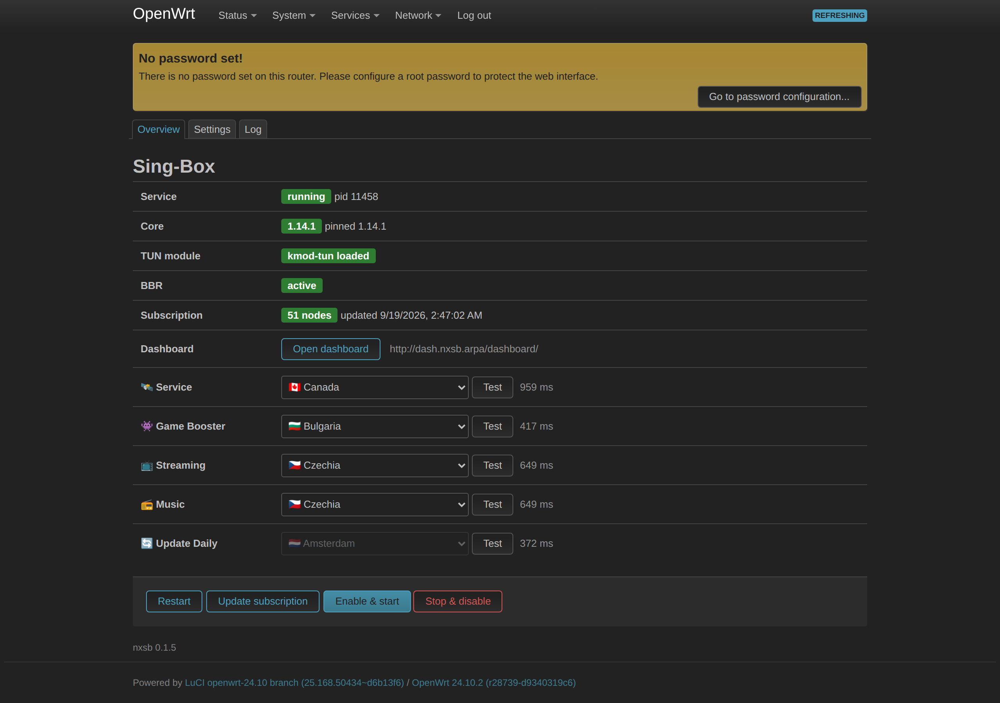
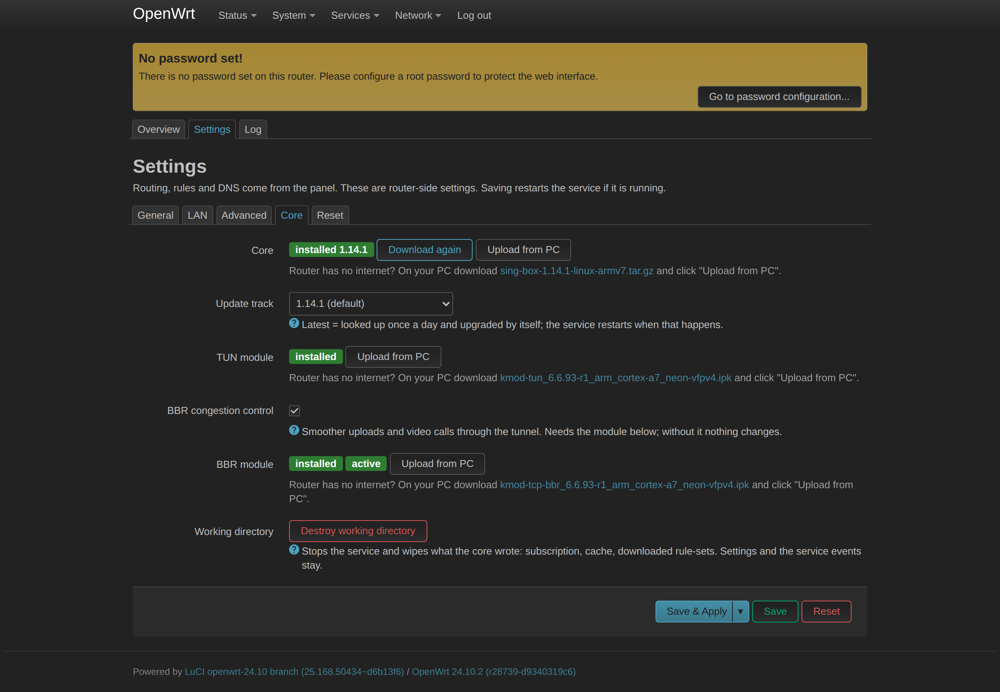
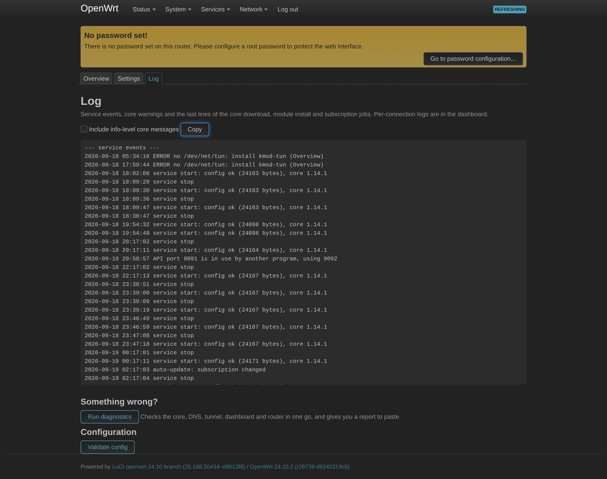
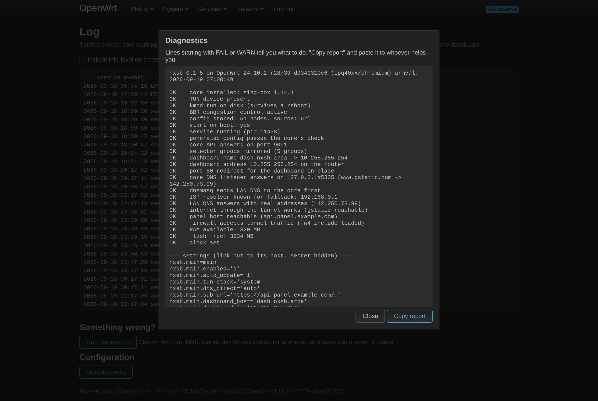
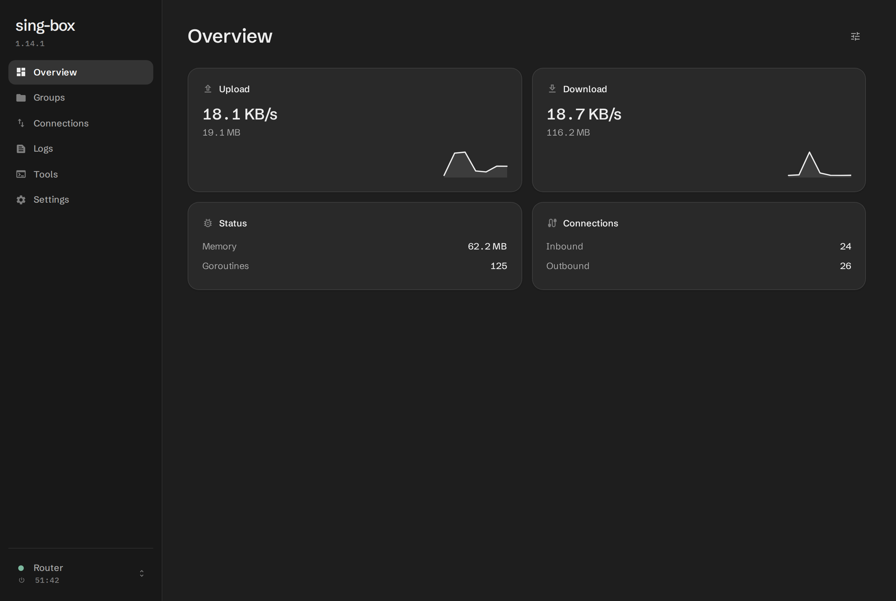
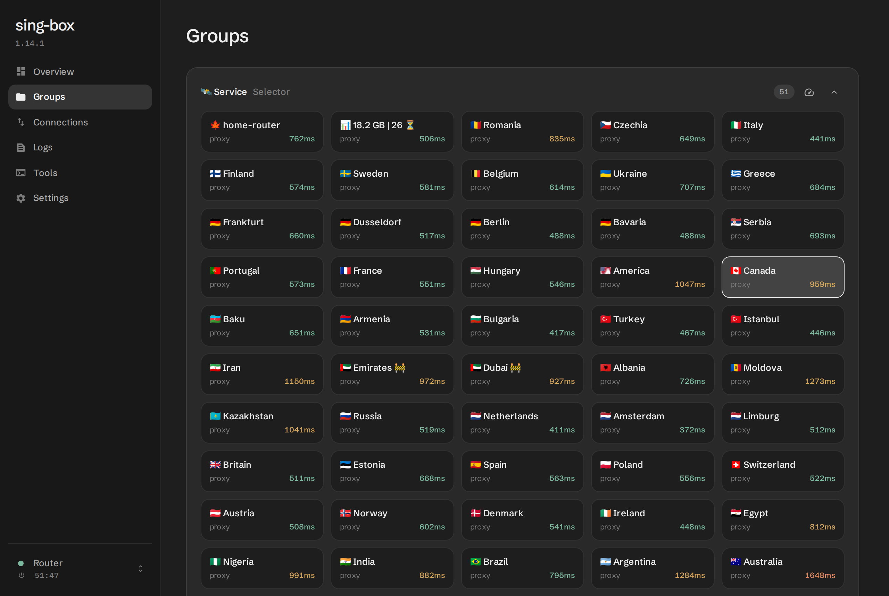
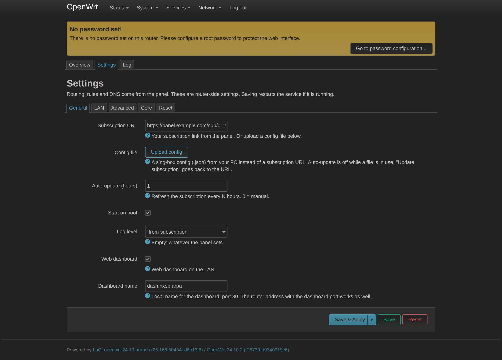
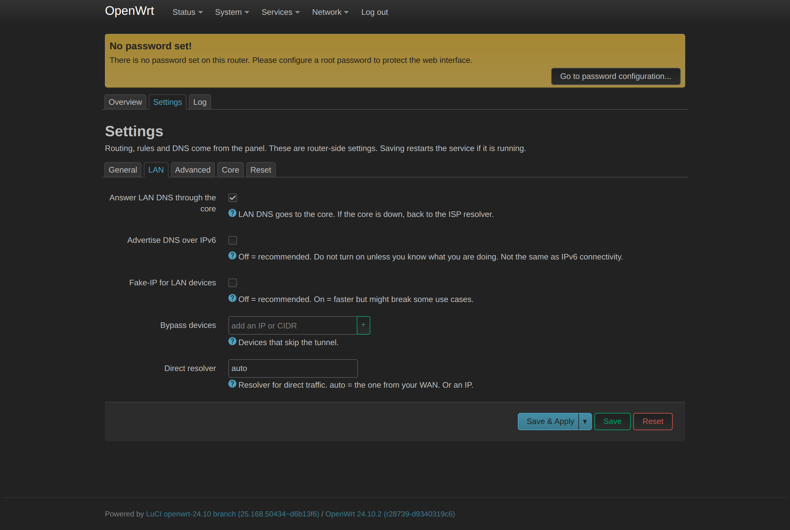
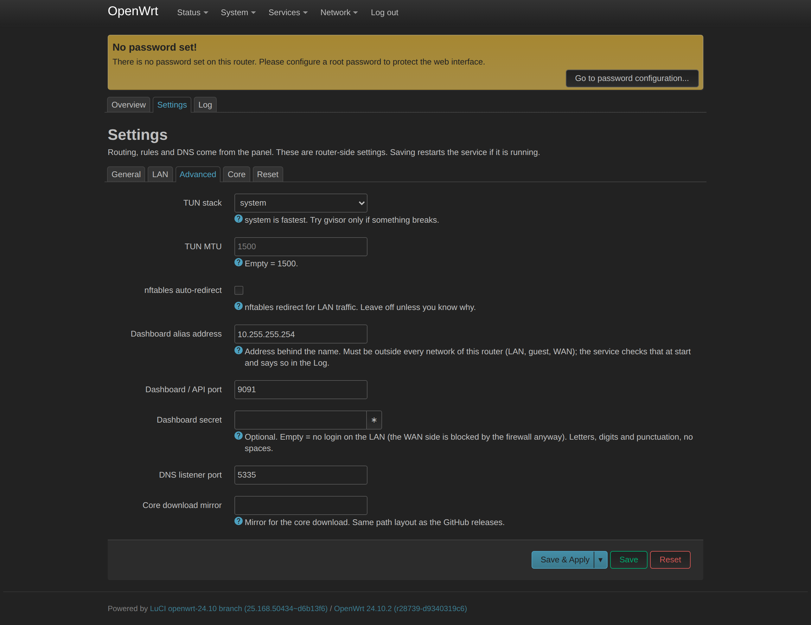
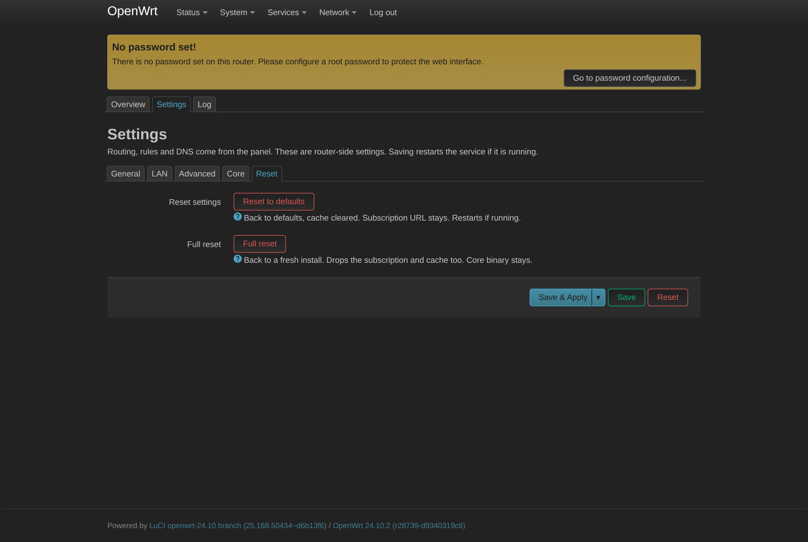

[English](README.en.md)

<div dir="rtl">

# Sing-box OpenWrt

استفاده و مدیریت آسان هسته Sing-box روی روتر OpenWrt.

تست‌شده روی Google Router با OpenWrt 24.10.

## تصاویر

| صفحه اصلی | تنظیمات » هسته |
|---|---|
| [](docs/screenshots/01-overview.png) | [](docs/screenshots/05-settings-core.png) |

| لاگ | عیب‌یابی |
|---|---|
| [](docs/screenshots/07-log.png) | [](docs/screenshots/08-diagnostics.png) |

| داشبورد | داشبورد » گروه‌ها و لوکیشن‌ها |
|---|---|
| [](docs/screenshots/09-dashboard-overview.png) | [](docs/screenshots/10-dashboard-groups.png) |

<details><summary>بقیه تب‌ها</summary>

[](docs/screenshots/02-settings-general.png)

[](docs/screenshots/03-settings-lan.png)

[](docs/screenshots/04-settings-advanced.png)

[](docs/screenshots/06-settings-reset.png)

</details>

## نصب و راه‌اندازی

۱. آخرین نسخه را از [ریلیزها](https://github.com/nxdomainx/sing-box-luci-app/releases/latest) دانلود کنید؛ برای هر نسل OpenWrt یک فایل، مناسب همه مدل‌های روتر:
   - **OpenWrt 24.10 و قدیمی‌تر** (opkg): فایل `.ipk`
   - **OpenWrt 25.12 و جدیدتر** (apk): فایل `.apk`

۲. **OpenWrt 24.10 و قدیمی‌تر:** در LuCI این مسیر را باز کنید و فایل را نصب کنید (یا با ترمینال). **OpenWrt 25.12 و جدیدتر:** فقط با ترمینال؛ آپلود LuCI بسته‌هایی را که امضای OpenWrt ندارند نصب نمی‌کند:

<div dir="ltr">

`System » Software » Upload Package`

</div>

با ترمینال هم می‌شود:

<div dir="ltr">

```bash
# OpenWrt 24.10 and older
opkg install /tmp/nxdomainx-luci-app-sing-box_<version>_all.ipk
# OpenWrt 25.12 and newer (not signed by OpenWrt, hence --allow-untrusted)
apk add --allow-untrusted /tmp/nxdomainx-luci-app-sing-box-<version>.apk
```

</div>

> **توجه:** هنگام نصب، روتر هسته Sing-box و ماژول‌های کرنل را از اینترنت دانلود می‌کند؛ به همین علت ممکن است کمی طول بکشد.

۳. لینک اشتراک را در این مسیر وارد و ذخیره کنید:

<div dir="ltr">

`Services » Sing-Box » Settings`

</div>

۴. در صفحه Overview ابتدا دکمه Update subscription و سپس Enable & start را بزنید.

## داشبورد

<div dir="ltr">

`http://dash.nxsb.arpa/dashboard/`

</div>

## نصب آفلاین

اگر روتر به اینترنت دسترسی ندارد، هسته و ماژول کرنل را در تب Core آپلود کنید. لینک فایل مناسب همان روتر هم همان‌جا نوشته شده.

## عیب‌یابی

در صفحه Log دکمه Run diagnostics را بزنید و بعد Copy report. می‌توانید با ترمینال هم عیب‌یابی کنید:

<div dir="ltr">

```bash
/etc/init.d/nxsb diag
```

</div>

## حذف

<div dir="ltr">

```bash
opkg remove nxdomainx-luci-app-sing-box   # OpenWrt 24.10 and older
apk del nxdomainx-luci-app-sing-box       # OpenWrt 25.12 and newer
```

</div>

</div>
